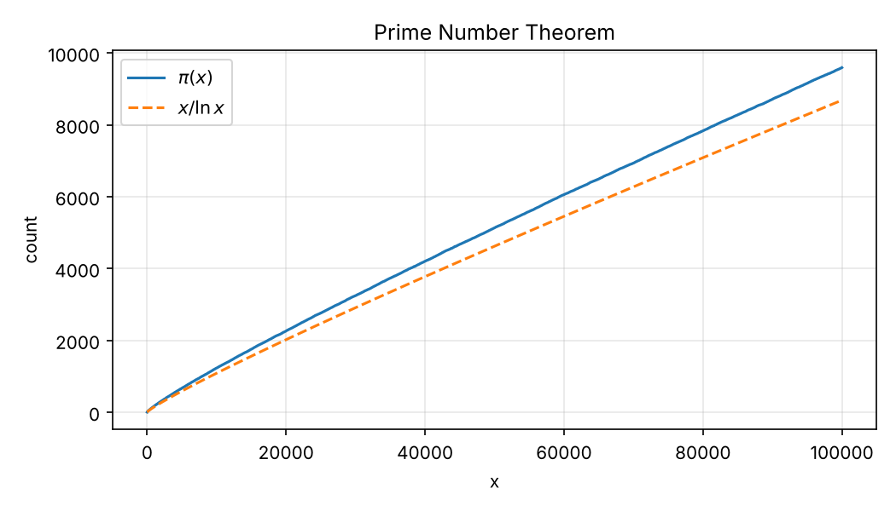
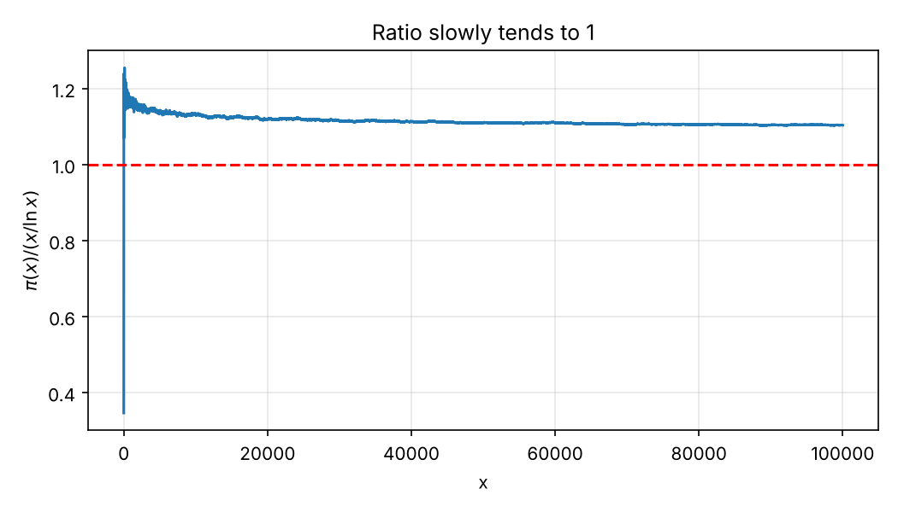
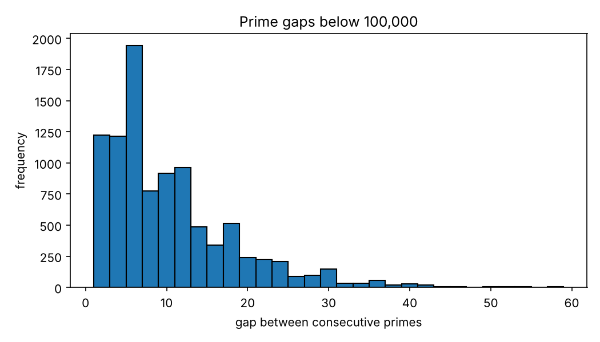
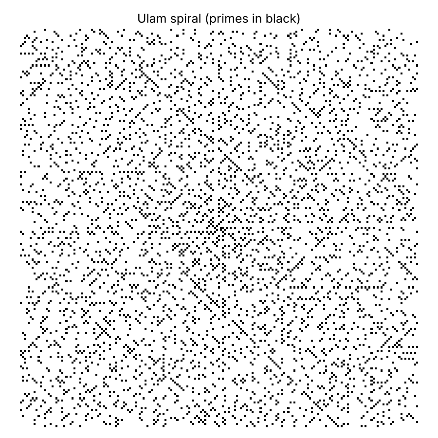
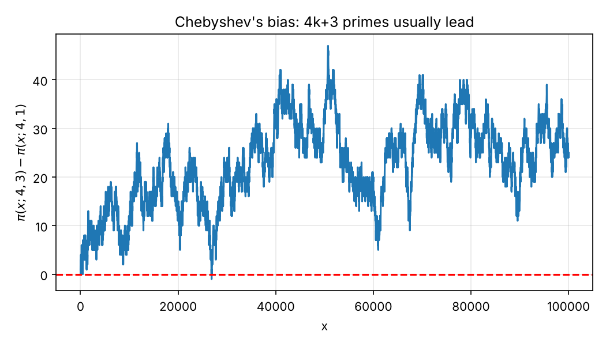

# CT #1 — Practicing Number Theory

**Name:** `<YOUR NAME>`  
**ID:** `<YOUR ID>`  
**Course / Submission:** CT#1, Number Theory & Cryptography practice  
**Code:** [`number_theory.py`](number_theory.py) (every output below was produced by running it)

> Reference: [mnp-club / NumberTheoryandCryptographyWorkshop](https://github.com/mnp-club/NumberTheoryandCryptographyWorkshop)

## Contents

1. [Primes and how to find them](#1-primes-and-how-to-find-them)
2. [Infinitely many primes](#2-infinitely-many-primes)
3. [Distribution of primes](#3-distribution-of-primes)
4. [Conjectures](#4-conjectures)
5. [Primality testing: Fermat, pseudoprimes, Carmichael](#5-primality-testing)
6. [Structure mod p: totient, primitive roots, Lucas test](#6-structure-modulo-p)
7. [Mersenne primes, Lucas-Lehmer, perfect numbers](#7-mersenne-primes-and-perfect-numbers)
8. [Antiprimes](#8-antiprimes-highly-composite-numbers)
9. [Cryptography: Euclid, modular inverse, RSA](#9-cryptography)
10. [How to run](#10-how-to-run)

---

## 1. Primes and how to find them

**Definition.** A natural number $p>1$ is *prime* if it is not a product of two smaller natural numbers. By the **Fundamental Theorem of Arithmetic**, every $n>1$ factors uniquely into primes, so primes are the building blocks of the integers.

### 1.1 Sieve of Eratosthenes
List $2,\dots,n$ and strike out multiples of every prime $p\le\sqrt n$. What remains is prime. Complexity is $O(n\log\log n)$.

```python
from math import isqrt

def sieve(n):
    is_p = [True] * (n + 1)
    is_p[0:2] = [False, False]
    for i in range(2, isqrt(n) + 1):
        if is_p[i]:
            for j in range(i * i, n + 1, i):   # start at i^2: smaller multiples already struck
                is_p[j] = False
    return [i for i, v in enumerate(is_p) if v]

print(sieve(50))
```
```
[2, 3, 5, 7, 11, 13, 17, 19, 23, 29, 31, 37, 41, 43, 47]
```

### 1.2 Trial division up to $\sqrt n$ with a wheel
If $n=ab$ with $a\le b$ then $a\le\sqrt n$, so it suffices to test divisors up to $\sqrt n$. A **wheel** skips numbers that are obviously composite. The wheel of 6 only tests $6k\pm1$. The wheel of 30 only tests residues $\{1,7,11,13,17,19,23,29\}\pmod{30}$, which removes 73% of candidates.

```python
def is_prime_trial(n):
    if n < 2: return False
    if n < 4: return True
    if n % 2 == 0 or n % 3 == 0: return False
    i = 5
    while i * i <= n:                 # only 6k-1 and 6k+1
        if n % i == 0 or n % (i + 2) == 0:
            return False
        i += 6
    return True
```

### 1.3 Divisibility tests (with proof idea)
Since $10\equiv1 \pmod 9$ (and mod 3), $n=\sum d_i10^i\equiv\sum d_i \pmod 9$, so $3\mid n\iff 3\mid$ digit sum. Since $10\equiv-1\pmod{11}$, $n\equiv\sum(-1)^id_i \pmod{11}$ (alternating digit sum). Since $1001=7\cdot11\cdot13$ and $10^3\equiv-1 \pmod{1001}$, alternating sums of 3-digit blocks test 7, 11 and 13. The test depends on the **base**: in base $b$, the same argument gives a digit-sum test for divisors of $b-1$.

### 1.4 A polynomial that produces many primes
$f(n)=n^2+n+41$ is prime for $n=0,\dots,39$, but `f(40) = 1681 = 41²` is composite. No non-constant polynomial in one variable is prime for all $n$. Matiyasevich showed a polynomial in about 10 variables has the set of its positive values equal to exactly the primes.

```python
print(next(n for n in range(100) if not is_prime_trial(n*n + n + 41)))   # 40
```

---

## 2. Infinitely many primes

### Proof 1 (Euclid)
Suppose $p_1,\dots,p_k$ are all the primes. Let $N=p_1\cdots p_k+1$. Any prime divisor $q$ of $N$ cannot be some $p_i$, since then $q\mid N-p_1\cdots p_k=1$. Contradiction. $\blacksquare$

*Food for thought: $\prod p_i-1$* works in exactly the same way. A prime $q\mid N$ again cannot be any $p_i$, because $q\mid p_1\cdots p_k$ would force $q\mid 1$. (Also $N>1$ once $k\ge2$.)

Note that $N$ itself need not be prime, only its prime divisors are new:

```python
def euclid_step(primes):
    N = math.prod(primes) + 1
    d = 2
    while N % d: d += 1
    return N, d      # smallest prime divisor of N
```
| known primes | $N=\prod p+1$ | smallest prime factor (new) |
|---|---|---|
| 2 | 3 | 3 |
| 2, 3 | 7 | 7 |
| 2, 3, 7 | 43 | 43 |
| 2, 3, 7, 43 | 1807 | **13** (1807 = 13·139) |
| 2, 3, 7, 43, 13 | 23479 | 53 |

Also $2\cdot3\cdot5\cdot7\cdot11\cdot13+1=30031=59\cdot509$ is composite.

### Proof 2 ($n!+1$)
Every $m\le n$ divides $n!$, so no $m\in[2,n]$ divides $n!+1$. Hence every prime factor of $n!+1$ is greater than $n$. So there are primes larger than any $n$. $\blacksquare$

### Proof 3 (Euler: divergence of the harmonic series)
Suppose only finitely many primes. For every $n$,

$$
\sum_{m=1}^{n}\frac1m \;<\; \prod_{p}\ \sum_{k=0}^{\lfloor\log_p n\rfloor}\frac1{p^k} \;<\; \prod_p\frac1{1-\frac1p}.
$$

The first inequality holds because each $m\le n$ is a product of prime powers $p^k$ with $p^k\le n$, so $1/m$ appears when the product is expanded. The right-hand side is a **finite** product of positive reals, hence a constant, but the harmonic series diverges. Contradiction. $\blacksquare$

### Proof 4 (Goldbach, via Fermat numbers)
Let $F_n=2^{2^n}+1$.

**Lemma.** $F_n$ and $F_m$ are coprime for $n\ne m$.  
*Proof.* By induction, $F_m-2=F_0F_1\cdots F_{m-1}$. If $d\mid F_n$ and $d\mid F_m$ with $n<m$, then $d\mid F_m-2$, so $d\mid2$. All Fermat numbers are odd, so $d=1$. $\blacksquare$

Picking one prime divisor of each $F_n$ gives infinitely many **distinct** primes. $\blacksquare$

### Proof 5 (Filip Saidak)
$n$ and $n+1$ are coprime, so $N_2=n(n+1)$ has at least 2 distinct prime factors. $N_2$ and $N_2+1$ are coprime, so $N_3=N_2(N_2+1)$ has at least 3. Continuing, $N_k$ has at least $k$ distinct prime factors for every $k$. $\blacksquare$

### Proof 6 (Furstenberg, topology)
Give $\mathbb Z$ the topology whose basic open sets are arithmetic progressions $a+b\mathbb Z$. Each progression is also closed (its complement is a union of other progressions). If there were finitely many primes, then $\bigcup_p p\mathbb Z=\mathbb Z\setminus\{\pm1\}$ would be a finite union of closed sets, hence closed, so $\{\pm1\}$ would be open. But no finite set is open (every nonempty open set is infinite). Contradiction. $\blacksquare$

### Proofs 7 & 8: special forms
* **Primes $\equiv1\pmod 4$.** Let $N=(2p_1\cdots p_k)^2+1$. An odd prime $q\mid N$ satisfies $x^2\equiv-1\pmod q$, which is solvable only if $q\equiv1\pmod4$, and $q\ne p_i$.
* **Primes $\equiv3\pmod4$.** Let $N=4p_1\cdots p_k-1\equiv3\pmod4$. It cannot have all prime factors $\equiv1\pmod4$ (a product of such is $\equiv1$), so some prime factor is $\equiv3 \pmod 4$, and it is not any $p_i$.

### Dirichlet's theorem
$ak+b$ has infinitely many primes iff $\gcd(a,b)=1$. Necessity is easy (a common factor divides every term). Sufficiency has **no elementary proof** (originally via Dirichlet $L$-series, which starts the field of *analytic number theory*).

---

## 3. Distribution of primes

Let $\pi(x)$ be the number of primes $\le x$. The **Prime Number Theorem** states

$$
\pi(x)\sim\frac{x}{\ln x}\quad\Longleftrightarrow\quad\lim_{x\to\infty}\frac{\pi(x)\ln x}{x}=1 .
$$

It was first proved using complex analysis and the Riemann zeta function, and an "elementary" proof (Erdős–Selberg) was found later.




The ratio converges to 1, but slowly. Prime gaps are irregular:



### Ulam spiral
Writing the integers in a square spiral and marking the primes reveals diagonal structure (prime-rich quadratic polynomials).



### Chebyshev's bias (prime number races)
Primes $\equiv3 \pmod 4$ usually lead primes $\equiv1\pmod4$, even though both classes have density $1/2$ (Dirichlet / PNT for progressions).



---

## 4. Conjectures

| Statement | Status |
|---|---|
| **Goldbach**: every even $n>2$ is a sum of two primes | Open. Verified computationally (below) |
| Every even $n$ is $p_1+p_2p_3$ ($p_2,p_3$ primes or 1) | Proved (Chen's theorem) |
| **Weak Goldbach / Waring**: every odd $n>5$ is a sum of three primes | Proved (Helfgott) |
| **Twin primes**: infinitely many $p$ with $p+2$ prime | Open |
| Infinitely many primes of the form $n^2+1$ | Open (Landau) |
| Infinitely many primes $n^2+m^2$ | True (Fermat: $p\equiv1\pmod4$) |
| A prime always exists between $n^2$ and $(n+1)^2$ | Open (Legendre) |

```python
print(all(any(is_prime_trial(p) and is_prime_trial(n-p) for p in range(2, n//2+1))
          for n in range(4, 10001, 2)))   # True
```

---

## 5. Primality testing

**Idea.** Find a statement $S$ such that *if $n$ is prime then $S(n)$ holds*. If $S$ fails, $n$ is composite. The converse can fail, giving **pseudoprimes**.

### 5.1 Fermat's Little Theorem
If $p$ is prime and $p\nmid a$, then

$$
a^{p-1}\equiv1\pmod p\qquad(\text{equivalently }a^p\equiv a).
$$

*Proof sketch.* The map $x\mapsto ax$ permutes $\{1,\dots,p-1\}$ mod $p$, so $a^{p-1}(p-1)!\equiv(p-1)!$, and $(p-1)!$ is invertible mod $p$.

```python
def fermat_test(n, a):
    return pow(a, n - 1, n) == 1     # fast modular exponentiation

print(fermat_test(341, 2), fermat_test(341, 3))   # True False   (341 = 11*31)
print(fermat_test(91, 3),  fermat_test(91, 2))    # True False   (91  = 7*13)
```

* **341** is a pseudoprime to base 2 but not base 3.
* **91** is a pseudoprime to base 3 but not base 2.
* Fermat pseudoprimes to base 2 below 2000 (computed): `[341, 561, 645, 1105, 1387, 1729, 1905]`. They are rare, so combining several bases helps. But...

### 5.2 Carmichael numbers
A composite $n$ with $a^n\equiv a\pmod n$ for all integers $a$ fools every Fermat test (with $\gcd(a,n)=1$).

**Korselt's criterion.** $n$ is Carmichael $\iff$ $n$ is composite, squarefree, and $(p-1)\mid(n-1)$ for every prime $p\mid n$.

Example: $561=3\cdot11\cdot17$. We have $2\mid560$, $10\mid560$, $16\mid560$. ✔

```python
print([n for n in range(3, 10000) if korselt(n)])
# [561, 1105, 1729, 2465, 2821, 6601, 8911]
```
There are **infinitely many** Carmichael numbers (Alford–Granville–Pomerance, 1994), and they are not as rare as one might expect.

---

## 6. Structure modulo $p$

For a prime $p>1$:

* Every nonzero residue mod $p$ is invertible. Equivalently, $\mathbb Z/p\mathbb Z$ is a field. (Conversely if $n=ab$ is composite then $a$ is a zero divisor, hence not invertible.)
* $\varphi(p)=p-1$, and $\varphi(n)=n-1\iff n$ is prime.
* The only solutions of $x^2\equiv1\pmod p$ are $x\equiv\pm1$ (since $p\mid(x-1)(x+1)$). This fails for composites, e.g. $x^2\equiv1\pmod 8$ has four solutions, and it is the idea behind Miller–Rabin.
* **Primitive roots** exist: some $a$ has multiplicative order exactly $p-1$, so $a,a^2,\dots,a^{p-1}$ are $1,\dots,p-1$ in some order.

```python
def phi(n): return sum(1 for k in range(1, n+1) if gcd(k, n) == 1)
def order(a, n):
    k, x = 1, a % n
    while x != 1: x = x*a % n; k += 1
    return k
def primitive_roots(p): return [a for a in range(1, p) if order(a, p) == p-1]

print(primitive_roots(11))   # [2, 6, 7, 8]
print(primitive_roots(13))   # [2, 6, 7, 11]
```

### Lucas' theorem (the $n-1$ test)
If there is $a$ with $a^{n-1}\equiv1\pmod n$ and $a^{(n-1)/q}\not\equiv1\pmod n$ for every prime $q\mid n-1$, then $n$ is **prime**.

*Proof.* The first two conditions force $\operatorname{ord}_n(a)=n-1$ (it divides $n-1$ but no $(n-1)/q$). Since $\operatorname{ord}_n(a)\mid\varphi(n)\le n-1$, we get $\varphi(n)=n-1$, so $n$ is prime. $\blacksquare$

```python
def lucas_n_minus_1(n):
    for a in range(2, n):
        if pow(a, n-1, n) != 1: continue
        if all(pow(a, (n-1)//q, n) != 1 for q in prime_factors(n-1)):
            return a      # witness proving n prime

print(lucas_n_minus_1(101), lucas_n_minus_1(97))   # 2 5
```
This is a *certificate*: unlike Fermat it proves primality. Strengthened versions (Pocklington/Proth, Pepin's test for Fermat numbers) only need a partial factorization $n-1=FR$ with $F>R$ and $\gcd(F,R)=1$.

---

## 7. Mersenne primes and perfect numbers

Mersenne's (wrong) belief: every $2^n-1$ is prime. If $2^n-1$ is prime then $n$ must be prime (because $2^{ab}-1=(2^a-1)(2^{a(b-1)}+\dots+1)$), but the converse fails, e.g. $2^{11}-1=23\cdot89$.

### Lucas–Lehmer test
Define $\ell_1=4$, $\ell_{k+1}=\ell_k^2-2$. For an odd prime $p$,

$$
M_p=2^p-1\ \text{is prime}\iff M_p\mid \ell_{p-1}.
$$

```python
def lucas_lehmer(p):
    if p == 2: return True
    s, M = 4, 2**p - 1
    for _ in range(p - 2):
        s = (s*s - 2) % M
    return s == 0

print([p for p in sieve(130) if lucas_lehmer(p)])
# [2, 3, 5, 7, 13, 17, 19, 31, 61, 89, 107, 127]
print(lucas_lehmer(67), lucas_lehmer(127))   # False True
```
* $2^{67}-1=147573952589676412927=193707721\times761838257287$ is **not** prime. (Cole's famous 1903 factorization.)
* $2^{127}-1$ **is** prime (Lucas, 1876), the largest prime ever proven by hand.

### Perfect numbers
$n$ is perfect if it equals the sum of its proper divisors. **Euclid–Euler:** an even number is perfect iff it is $2^{p-1}(2^p-1)$ with $2^p-1$ a Mersenne prime.

```python
print([n for n in range(2, 10000) if sum(d for d in range(1, n) if n % d == 0) == n])
# [6, 28, 496, 8128]  ->  2*3, 4*7, 16*31, 64*127
```

---

## 8. Antiprimes (highly composite numbers)

$n$ is an antiprime if every smaller number has strictly fewer divisors. If $n=\prod p_i^{a_i}$ then the divisor count is

$$
d(n)=\prod_i(a_i+1)
$$

(each divisor chooses an exponent $0..a_i$ independently). In an antiprime the primes used are *consecutive* ($2,3,5,\dots$) and the exponents are non-increasing, $a_1\ge a_2\ge\cdots$, otherwise swapping exponents or replacing a prime by a smaller one gives a smaller number with at least as many divisors.

```python
print(antiprimes(400))
# [1, 2, 4, 6, 12, 24, 36, 48, 60, 120, 180, 240, 360]
```
This explains why 12, 24, 60 and 360 appear in clocks, angles and calendars.

---

## 9. Cryptography

Primes matter in cryptography because multiplying two large primes is easy while factoring the product is believed to be hard.

### 9.1 Extended Euclidean algorithm and modular inverse
$\gcd(a,b)=ax+by$ (Bézout). If $\gcd(a,m)=1$ then $x$ is the inverse of $a$ mod $m$.

```python
def egcd(a, b):
    if b == 0: return a, 1, 0
    g, x, y = egcd(b, a % b)
    return g, y, x - (a // b) * y

def modinv(a, m):
    g, x, _ = egcd(a, m)
    assert g == 1
    return x % m

print(egcd(240, 46))   # (2, -9, 47):  240*(-9) + 46*47 = 2
```

### 9.2 RSA (toy example)
1. Choose primes $p,q$. Let $n=pq$ and $\varphi(n)=(p-1)(q-1)$.
2. Choose $e$ with $\gcd(e,\varphi(n))=1$. Let $d=e^{-1}\bmod\varphi(n)$.
3. Encrypt $c=m^e\bmod n$. Decrypt $m=c^d\bmod n$.

Correctness follows from Euler's theorem: $ed\equiv1\pmod{\varphi(n)}\Rightarrow m^{ed}\equiv m\pmod n$.

```python
def rsa_demo(p=61, q=53, e=17, msg=65):
    n, ph = p*q, (p-1)*(q-1)
    d = modinv(e, ph)
    c = pow(msg, e, n)
    return n, ph, d, c, pow(c, d, n)

print(rsa_demo())   # (3233, 3120, 2753, 2790, 65)
```
So $n=3233$, $d=2753$, ciphertext $2790$, and decryption recovers $65$. ✔ (Real RSA uses 2048-bit+ primes and padding. This is for learning only.)

---

## 10. How to run

```bash
pip install numpy matplotlib
python number_theory.py     # prints every output above and regenerates ./figures
```
Works as-is in Google Colab or Jupyter (paste the module into a cell, or upload the file and `%run number_theory.py`).

## Summary

| Topic | Key takeaway |
|---|---|
| Infinitude | Many independent proofs (Euclid, Euler, Goldbach, Saidak, Furstenberg) |
| PNT | $\pi(x)\sim x/\ln x$ |
| Fermat test | Fast but fooled by pseudoprimes and Carmichael numbers |
| Lucas $n-1$ test | Gives a *proof* of primality |
| Lucas–Lehmer | Efficient test for Mersenne numbers, links to perfect numbers |
| RSA | Security rests on the difficulty of factoring |
